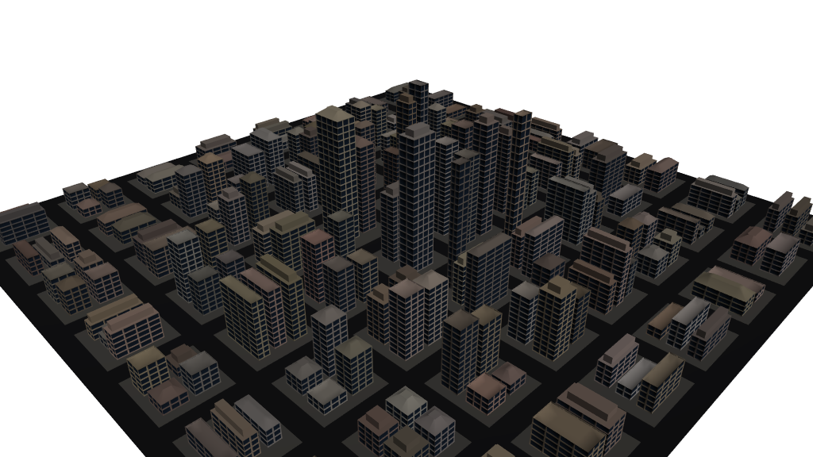
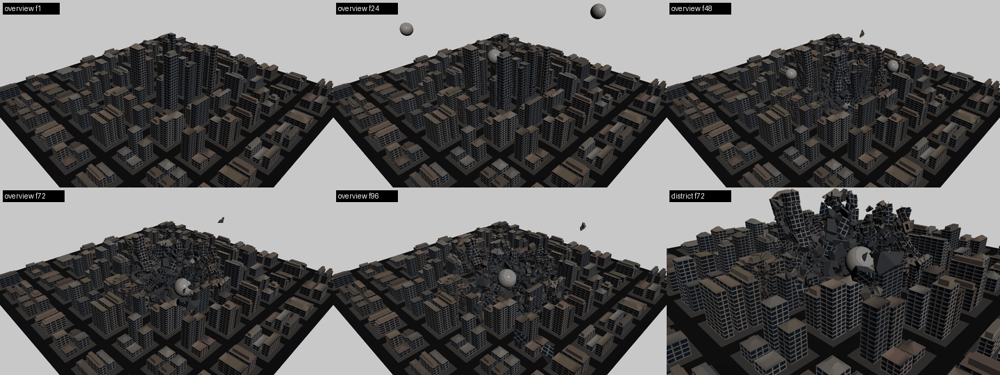

# HocusPocus

HocusPocus is an [MCP](https://modelcontextprotocol.io) server that lets AI agents
(Claude Code, Codex, any MCP client) drive a live SideFX Houdini session: build and change
networks, set parms, cook, read geometry and USD stages, look at the result, render, and
open, save and merge hip files. It speaks Houdini's own vocabulary. Identity is node paths
and parm paths, graphs are read and written in Houdini's native `hou.data` format, and
there is a Python escape hatch for everything else.

It runs as two processes. A thin **bridge** (`hocuspocus-mcp`, standard CPython plus the
official `mcp` SDK) talks MCP over stdio to your client. A small stdlib-only **host**
runs inside Houdini, GUI or headless `hython`. The bridge finds or launches a Houdini
and forwards each tool call over an authenticated loopback HTTP channel. The host runs
every `hou` call on Houdini's main thread, every scene change as one named undo group, and
returns compact JSON. Errors carry a stable `code`, a `hint` and, when a name was close,
`candidates`. The design is in [`docs/BIBLE.md`](docs/BIBLE.md).

## What changed in 2.0

Every evaluation of 1.x measured calls per task and bytes per call, and the 1.x contract
(one tool per noun, every read a tool call, every change its own round trip, four capture
sources behind one argument) had reached its limits. 2.0 changes the contract where the
evidence says it matters: `edit` makes every scene change of a task in one call and one
undo step, `inspect` and `search` replace eleven read tools while every read is also a
resource with an ETag, and `look` picks the renderer from a `quality` level instead of
asking the agent to choose one. A bridge ledger remembers Houdinis, their roles and jobs
across restarts, so `cook`, `render` and `look` run on a headless worker with
`on: "worker"` while the GUI stays pinned. The default profile has 18 tools instead of
31, and its `tools/list` is about 20 KB instead of 27 KB.
[`docs/migration-2.0.md`](docs/migration-2.0.md) maps every removed tool to its
replacement (2.0.x's `compat_1x` profile, which kept 1.4 scripts running, is removed in
2.1).

## What it can do

In one test session an agent built a 191-building procedural city, fractured 30 buildings
and simulated 96 frames of meteors hitting them, with two `houdini_python` calls and
otherwise only the typed tools (reviews [08](docs/redesign/review/08-city-build-log.md),
[09](docs/redesign/review/09-city-destruction-log.md)). Later evaluations covered Solaris
and Karma ([13](docs/redesign/review/13-solaris-lookdev-eval.md)), PDG ([14](docs/redesign/review/14-pdg-wedge-eval.md)),
a GUI session next to a user ([15](docs/redesign/review/15-gui-session-eval.md)), FX caching
([17](docs/redesign/review/17-fx-sim-cache-eval.md)), Copernicus ([18](docs/redesign/review/18-copernicus-eval.md)),
two Houdinis ([19](docs/redesign/review/19-two-instances-and-prompts-eval.md)), a scorecard re-run
([21](docs/redesign/review/21-scorecard-1.3.md)), a 1,230-call soak ([22](docs/redesign/review/22-soak-1.3.md))
and Vellum through USD to Karma ([23](docs/redesign/review/23-vellum-usd-eval.md)). Five are
now the workloads test tier, which fails a change that makes an agent pay more than 1.4.
In 2.1 an agent built a game-ready skyscraper generator ([26](docs/redesign/review/26-neo-tower-dogfood.md),
[`examples/neo_tower`](examples/neo_tower/README.md)). The
[`procedural-assets`](.claude/skills/procedural-assets/SKILL.md) skill teaches agents the
coarse-to-fine method technical artists use for such generators; Claude Code loads it in this
repository ([29](docs/redesign/review/29-procedural-assets-skill.md)).





- [Karma lookdev](docs/redesign/evidence/city-destruction/30_lookdev_karma.png): the city in `/stage` with MaterialX materials, a dome and a key light, Karma CPU at 640×360 (review 13).
- [PDG wedges](docs/redesign/evidence/city-destruction/40_pdg_wedges.png): eight building-generator wedges cooked through ROP Fetch TOPs, one OpenGL capture each (review 14).
- [GUI viewer](docs/redesign/evidence/city-destruction/50_gui_viewer.png): `viewport_capture` through `cam_district` at frame 72, `opengl_rop` source, in a live GUI Houdini (review 15).
- [Pyro cache](docs/redesign/evidence/city-destruction/60_pyro_frames.png): a smoke plume cached with a File Cache and flipbooked with an OpenGL ROP, frames 1 to 48 (review 17).
- [Copernicus city map](docs/redesign/evidence/city-destruction/70_copernicus_citymap.png): a COP network's image written by `rop_image`, and the SOP city that reads it through `op:` (review 18).
- [Two instances](docs/redesign/evidence/city-destruction/80_two_instance_render.png): frames of a render on a headless worker while the GUI Houdini kept editing (review 19).
- [Soak latency](docs/redesign/evidence/city-destruction/90_soak_latency.png): latency per call and host memory over a 616-call session on one headless Houdini (review 22).
- [Vellum to USD to Karma](docs/redesign/evidence/city-destruction/100_vellum_usd_karma.png): a Vellum cloth cached, exported with a `usd_rop`, re-imported with `sublayer` and rendered with Karma at frame 24 (review 23).

## Requirements

- SideFX Houdini **22.0 or newer**, tested on 22.0.466 (`doctor` warns on other 22.x).
- [uv](https://docs.astral.sh/uv/), which provides the Python 3.11+ the bridge needs.
- An MCP client such as Claude Code or Codex.

## Install

HocusPocus is not on PyPI yet, so install it from a checkout:

```bash
git clone https://github.com/JJ-Ju/hocus-pocus && cd hocus-pocus
uv tool install -e .                          # puts hocuspocus and hocuspocus-mcp on PATH
hocuspocus install-houdini                    # add --dev to load this checkout's src/
claude mcp add -s user hocuspocus -- hocuspocus-mcp
hocuspocus launch                             # scripted clients: a Houdini no client owns
```

`-s user` registers the server for every directory. Without it, Claude Code registers it
for the current project only. Once HocusPocus is published, `uv tool install hocuspocus`
will replace the first two lines. Interactive users can simply open Houdini; one-shot
scripts and short sessions should start it with `hocuspocus launch`
([below](#scripted-clients-hocuspocus-launch)), so it outlives them.

`hocuspocus install-houdini` installs into every user pref dir Houdini may use (on
Windows, `Documents\houdini22.0` from the Start menu and `%HOME%\houdini22.0` from a
shell that sets `HOME`), names each one, and records them for the bridge. It is
idempotent; `hocuspocus uninstall-houdini` undoes it. The quickstart lists the candidates.

For Codex, `hocuspocus client-config codex` prints the `~/.codex/config.toml` entry
(`[mcp_servers.hocuspocus]` with `command = "hocuspocus-mcp"`).

**Restart Houdini** after `install-houdini`. The package loads at startup. In a GUI
session, the host starts by itself once the UI is ready. The HocusPocus shelf has
HP Status, HP Start and HP Stop buttons.

Then run `hocuspocus doctor`. It checks the Houdini install and version, the pref dir
and `hocuspocus.toml` the bridge reads, that the package JSON points at a `hocuspocus`
matching the bridge, and each live instance's `/health`; every failure says what to run.
[`docs/quickstart.md`](docs/quickstart.md) has the full walkthrough and troubleshooting.


## First session

You ask: *"Make a terrain from a grid with a mountain on it and show me."* The agent
then makes these calls:

```text
houdini_status {}
  -> {"connected": {"pid": 18244, "houdini": "22.0.466", "ui": true, "role": "editor",
       "hip": {"name": "untitled.hip", "dirty": false}, ...}, "instances": [...]}
edit    {"ops": [
          {"op": "create", "id": "geo", "parent": "/obj", "type": "geo", "name": "terrain"},
          {"op": "create", "id": "grid", "parent": "$geo", "type": "grid",
           "parms": {"size": [10, 10], "rows": 100, "cols": 100}},
          {"op": "create", "parent": "$geo", "type": "mountain", "name": "mtn",
           "inputs": [{"index": 0, "from": "$grid"}], "flags": {"display": true, "render": true}}]}
  -> {"results": [{"op": "create", "id": "geo", "path": "/obj/terrain"}, ...],
      "nodes": [..., {"path": "/obj/terrain/mtn", "type": "mountain", "errors": [],
                      "warnings": [], "cook_state": "cooked", "cook_ms": 41}], "dirty": true}
inspect {"what": "geo", "target": "/obj/terrain/mtn"}
  -> {"what": "geo", "target": "/obj/terrain/mtn", "etag": "18244:1:…",
      "point_count": 10000, "prim_count": 9801, "bbox": {...}, "attributes": {...}}
look    {"target": "/obj/terrain"}
  -> [PNG image] + {"backend_used": "flipbook", "quality": "draft", "camera_used": "temporary", ...}
```

The `edit` call is one undo step (Ctrl+Z, or the `undo` tool). `$geo` and `$grid` name
nodes earlier ops created, and the `nodes` rows already carry each node's errors, so no
separate cook is needed; `"dry_run": true` would have checked the ops without changing
anything. Output shortened; [`docs/tools.md`](docs/tools.md) has the real schemas.

## Tools

There are 19 tools in the default `core` profile (2.1 adds `hda`). `full` adds 2, and
`minimal` lists 10
for clients with a small context. Each is documented in [`docs/tools.md`](docs/tools.md)
(and the `hocuspocus://tools` resource), generated from one spec file per tool.

| Group | Tools |
|---|---|
| Session and instances | `houdini_status`, `houdini_connect` (attach, launch, pin by pid, name or role) |
| Hip file | `hip_new`, `hip_open`, `hip_save`, `hip_merge` |
| Read | `inspect` (`what`: node, parms, network, outline, geo, image, stage, problems, type, events, jobs), `search` (`kind`: types or nodes) |
| Change | `edit` (ops: create, delete, connect, set, node, copy, layout, build, select, in one transaction), `node_create`, `parm_set` |
| Cook, render, look | `cook` (incl. `profile` and `frame_range`), `render`, `look` (`quality`: draft, lit, final) |
| Code and jobs | `houdini_python`, `job` |
| State | `undo`, `time` |
| Digital assets | `hda` (create, save, unlock, match, install, uninstall, reload, list, info) |
| `full` profile only | `pdg`, `events` |

The bridge also serves resources and prompts, and `tools/list` works with no Houdini
running:

- **Resources:** `houdini://outline` (the scene as a compact tree), `status`,
  `instances`, `jobs`, `node/{path}`, `network/{path}`, `geo/{path}`, `image/{path}`,
  `stage/{lop}`, `type/{category}/{name}`, `types`, `problems`, `events`, each with an ETag
  (`status`, `jobs`, `events`, `node` subscribable); `hocuspocus://guide` (manual and
  recipes) and `hocuspocus://tools` (the tool reference).
- **Prompts:** `inspect_scene`, `build_sop_chain`, `debug_red_node`, `turntable_preview`,
  `cache_sim`, `two_houdinis`, `lookdev_karma`.

`look` shows the display, or the `target` you name (object, SOP, LOP, Cop node or ROP):
`draft` through a Flipbook ROP framed on it, GUI or headless (0.4 s after a 3 s first
headless look), `lit` with the scene's lights, `final` with Karma; `source: "viewer"`
grabs the GUI Scene Viewer as you see it. To write a cache, `render` the File Cache
(`cook` never writes files): it runs as a job you can poll and cancel.

**Upgrading from 1.4.** `node_info`, `viewport_capture` and the other per-noun tools are
gone; called, each answers `invalid_argument` naming its replacement. 2.1 removed
`profile = "compat_1x"`, which served them for 2.0.x; left in a config it reads as `full`
with a warning: [`docs/migration-2.0.md`](docs/migration-2.0.md).

## Headless use and launching

An agent can start its own Houdini, GUI or headless:

```text
houdini_connect {"launch": {"mode": "headless", "hip": "C:/work/shot.hip"}}
```

Headless runs `hython -m hocuspocus.host`; GUI runs `houdinifx` (or `houdini`), found
through the `hfs` setting, `HOCUSPOCUS_HFS`, `HFS`, then the newest `Houdini 22.*`. The
bridge waits until the new instance registers. It starts in `HOCUSPOCUS_WORK_DIR`
(default: your home directory), the `$HIP` and `$JOB` of its untitled scene;
`hocuspocus launch` (below) starts in the directory you run it from instead.

> **Launch lifetime.** A Houdini started with `houdini_connect {launch}` exits with the
> bridge that launched it (the end of a session, or a one-shot script exiting), losing
> unsaved work. `hip_save` first, or start it with `hocuspocus launch` (below).

### Scripted clients: `hocuspocus launch`

This is the recommended way to start Houdini for one-shot scripts and short MCP
sessions. The Houdini it starts belongs to no MCP server and keeps running:

```bash
hocuspocus launch                      # GUI houdinifx with the package loaded
hocuspocus launch --headless --hip C:/work/shot.hip --wait 120
hocuspocus launch --headless --work-dir C:/work/shot010   # $HIP/$JOB of the untitled scene
{"pid": 23310, "port": 53120, "label": "hython", "hip": "C:/work/shot.hip", ..., "mode": "headless"}
```

It uses the same Houdini detection and package path rules as `houdini_connect {launch}`,
waits up to `--wait` seconds (default 90; `0` returns at once) for the host to register,
prints the registry entry (never the token) as one JSON line, and exits. Houdini starts
in the directory the command runs in (or `--work-dir DIR`), so the untitled scene's `$HIP`
and `$JOB` are where you expect. Later sessions attach with
`houdini_connect {"pid": 23310}`, or pick it automatically when it is the only one
running. Close it with `houdini_connect {"quit": true, "on_unsaved": "save"}` (1.2;
`fail`, the default, refuses with unsaved changes), or a GUI one as usual. To run the
host by hand instead, use `hython -m hocuspocus.host [--hip FILE] [--port N]
[--read-only] [--no-python] ...` from a neutral directory (hython puts its cwd on
`HOUDINI_PATH`); it prints `{"pid", "port", "token_file"}` and serves until stopped.
Headless, only `look {"source": "viewer"}` needs the UI (`ui_required`).

**Two Houdinis.** Run the GUI for editing and a `hocuspocus launch --headless` worker.
`houdini_status` lists each with its role (`editor` for a GUI, `worker` headless), `busy`
and `jobs_running`; `houdini_connect {"role": "editor"}` pins one. Until one is pinned,
calls that change a scene refuse with `ambiguous_instance`, and a pinned Houdini that exits
gives `instance_lost`, never a silent switch. `render {"rop_path": "/out/karma1", "on":
"worker", "wait_s": 0}` renders on the worker without moving the pin, and `job` follows
the job there by id, even after the MCP server restarts.

## Configuration

Everything has a default, and no configuration file is required.

One optional file, `$HOUDINI_USER_PREF_DIR/hocuspocus.toml`, serves both the host
(inside Houdini) and the bridge (`hocuspocus-mcp`). Each key can be overridden by an
environment variable named `HOCUSPOCUS_<KEY>`, for example `HOCUSPOCUS_ALLOW_PYTHON=0`;
**the environment always wins over the file**. A `[hocuspocus]` table is also accepted.
Unknown or invalid keys are logged and ignored.

```toml
autostart = true            # host: GUI sessions start the host when the UI is ready
allow_python = true         # host: houdini_python escape hatch
read_only = false           # host: refuse all mutating tools
approved_roots = []         # host: if non-empty, hip/hda/render paths must be under these
max_response_bytes = 16384  # both: response budget
default_timeout_s = 30      # both: per-call timeout
job_threshold_s = 10        # host: cooks longer than this become jobs
profile = "core"            # both: "minimal" (10 tools), "core" (18), "full" (21: adds hda, pdg, events)
hfs = ""                    # bridge: Houdini install used by houdini_connect launch
result_content = "text"     # bridge: text | both | structured (where result JSON goes)
log_level = "INFO"          # host
```

The bridge reads the file from `HOUDINI_USER_PREF_DIR` when it is set, else from the
first recorded or default pref dir that has one (`hocuspocus doctor` prints which). The
host enforces `profile` too, so set it in `hocuspocus.toml`, which both read, or in
Houdini's environment as well as the client's, and restart Houdini.

| Bridge variable | Default | Meaning |
|---|---|---|
| `HOCUSPOCUS_PROFILE` | `core` | `minimal` lists 10 tools; `full` also lists `hda`, `pdg`, `events` |
| `HOCUSPOCUS_MAX_RESPONSE_BYTES` | `16384` | response budget; lists are truncated with `truncated: true` |
| `HOCUSPOCUS_DEFAULT_TIMEOUT_S` | `30` | per-call timeout sent to the host |
| `HOCUSPOCUS_HFS` | auto | Houdini install used by `houdini_connect` launch |
| `HOCUSPOCUS_RESULT_CONTENT` | `text` | where result JSON goes: `text` block only, `both` (adds `structuredContent`), or `structured` |
| `HOCUSPOCUS_WORK_DIR` | home | where `houdini_connect {launch}` starts Houdini (environment only; `hocuspocus launch` uses its cwd or `--work-dir`) |

`HOCUSPOCUS_STATE_DIR` moves the state directory (instance registry, the bridge's
`ledger.sqlite`, logs, captures): `%LOCALAPPDATA%\HocusPocus` on Windows and
`$XDG_STATE_HOME/hocuspocus` (or `~/.local/state/hocuspocus`) elsewhere.

## Security model

HocusPocus is a localhost developer tool, and its protection is scoped to match:

- **Network.** The host binds only to `127.0.0.1`, on an ephemeral port.
- **Token.** Each instance has its own bearer token. It is stored in a registry file
  that only your user can read.
- **Browser requests.** Requests with a non-loopback `Origin` or `Host` header are
  refused, which also stops DNS rebinding.
- **Settings.** `allow_python = false` disables the Python escape hatch,
  `read_only = true` refuses every mutation, and `approved_roots` restricts the file
  paths that hip, HDA and render tools may touch.
- **Undo and unsaved work.** Every mutating call is exactly one undo group. Hip tools
  never discard unsaved work unless told to with `on_unsaved`.

There are no integrity manifests or rate limits. Those would not stop an agent that
already has a shell on your machine.

## Status and versioning

1.0 was merged to `master` on 2026-10-12 (tag `v1.0.0`), and 1.1 to 1.4 followed (tags
`v1.1.0` to `v1.4.0`), then 2.0 (tag `v2.0.0`). 2.1 is the current release (tag `v2.1.0`):
[`CHANGELOG.md`](CHANGELOG.md) lists its changes and
[`docs/migration-2.1.md`](docs/migration-2.1.md) what a 2.0 client can notice
([`docs/migration-2.0.md`](docs/migration-2.0.md) covers 1.x). HocusPocus is not on PyPI yet. It is
qualified on Windows with Houdini 22.0.466; the code is not Windows-only, but Linux and
macOS are untested. GUI/headless differences: [`docs/parity.md`](docs/parity.md).

The host/bridge protocol is versioned (`hp/v1` calls, `hp/v2` resource reads); on
`version_mismatch`, run `hocuspocus install-houdini` and restart Houdini.

The 0.9 line is preserved at the `v0.9-archive` tag. The reviews, evaluations and the
2.0 specification are indexed in [`docs/redesign/README.md`](docs/redesign/README.md);
contributing and release steps are in [`docs/CONTRIBUTING.md`](docs/CONTRIBUTING.md).

## License

MIT. See [`LICENSE`](LICENSE).
