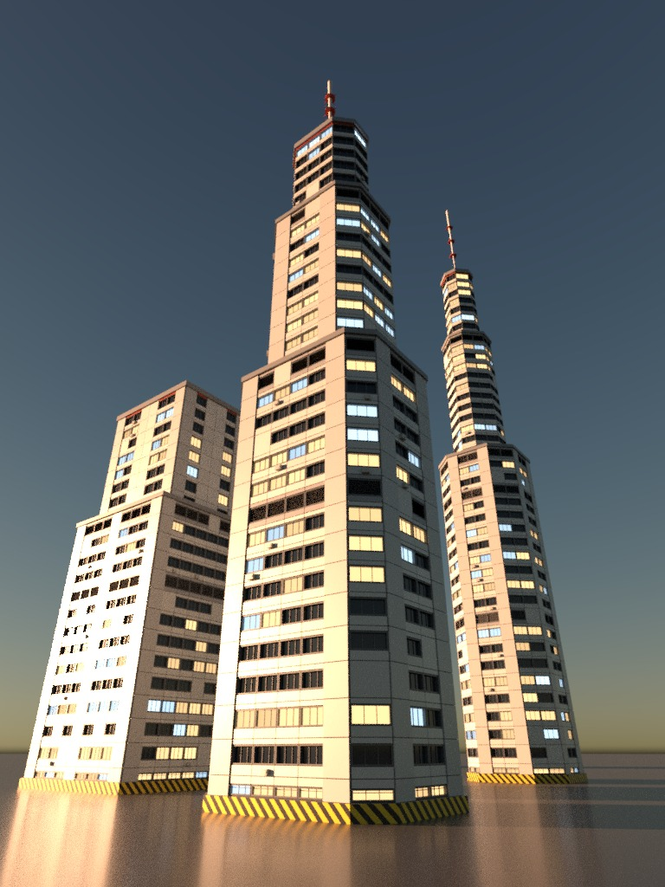

# Review 28: the same generator brief on 2.0.0 and on 2.1

2026-10-24. This review is the 2.1 re-run that plan-2.1 §3 stream D asks for. Two fresh
Claude Code sessions (Opus 5.5, `claude -p`, nothing else in context) got the same brief:
build a compact procedural skyscraper SOP asset `hp::mini_tower::1.0` from scratch, in
the Tokyo-3 and Neo-Tokyo look, with massing, facade, a toggleable interior, an HDA with a
tabbed interface, two MaterialX materials, UVs, an LOD, collision, an FBX export and saved
evidence images. The brief's seven scope items are the areas where the neo_tower dogfood
(review 26) hit friction.

Each session ran with its own bridge, state dir and Houdini pref dir, so each Houdini
loaded its own host:

| Run | Bridge | Host | Profile |
|---|---|---|---|
| r20 | 2.0.0 (tag `v2.0.0`) | 2.0.0 | `core`, 18 tools |
| r21 | `release/2.1` at `c350194` | the same | `core`, 19 tools |

Both briefs called the server "HocusPocus 2.1", so r20's log carries that title. Its
bridge and host were 2.0.0. The sessions ran at the same time on one machine. Their own
logs are in `28-logs/`.

## 1. Result

Both sessions delivered every scope item. The towers are of similar quality, which is
what one hand-written VEX generator in about 40 minutes gives.

| | r20 (2.0.0) | r21 (2.1) |
|---|---:|---:|
| Wall time | 40.1 min | 38.8 min |
| HocusPocus calls | 126 | 175 |
| HocusPocus errors | 9 | 10 |
| Errors fixed in one step from the hint | 7 of 9 | 10 of 11 |
| `houdini_python` escapes | **7** | **1** |
| Calls to the client's own tools (shell, file reads, resource reads, monitor) | 34 | 9 |
| Text sent / received by HocusPocus calls | 98 KB / 90 KB | 105 KB / 141 KB |
| Evidence images | 5 | 7 |

Counts come from the stream-json transcripts. The per-item counts in the logs are the
agents' own and are within a few calls of them.

 

## 2. Where the difference is

| Scope item | r20 calls / escapes | r21 calls / escapes | What changed |
|---|---|---|---|
| Massing, facade, interior | 24 / 0 | 27 / 0 | Both built the graph in one or two large `edit` calls. r21 fixed two VEX compile errors with `patch` instead of resending the snippet. |
| Asset | 8 / 3 | 26 / 1 | r20 made, saved and installed the HDA and wrote its interface through `hou`. r21 did all of it with `hda` and `spare_parms` (`folder_type`, `disable_when`, help). Its one escape read the conditionals back, which no read shows (stream D5). |
| Materials | 17 / 4 | 24 / 0 | r20 ran the Karma Material Builder tab tool and set MaterialX signatures through `hou`, because `edit` rejected `color3` with the candidate `default`. r21 built VOP subnets with the `material` flag (D68) and no escapes. |
| Game prep | 16 / 0 | 19 / 0 | Similar. |
| Evidence | 51 + client shell work / 0 | 69 / 0 | r20 converted and resized images in the shell. r21 saved through `look {output}` but spent about 25 calls on JPEG size and a stale File COP. |

r21 made more HocusPocus calls because it kept the asset, material and image work inside
the tools, and because it made more variants, two more images and a USD check. Calls are
therefore not comparable one to one here. Escapes and calls to the client's own tools are.

## 3. What both runs still hit

1. **A final-quality `look` cannot run past about 30 s.** Both runs ranked this first. The
   Karma look answers `houdini_busy`, the image is lost, and the hint names `timeout_s`
   and jobs, which `look` does not take. Stream D4 adds `wait_s` and a job to `look`.
2. **Image size control.** Neither run could set JPEG quality, so both cut resolution to
   stay under the brief's 300 KB. Stream D5.

## 4. New friction from r21

All of these are in stream D5, except the `inspect geo` shapes, which are in D4.

- A File COP keeps serving the old image after the file on disk changes, even after
  `cook {force: true}`. Three saved images were stale before the agent noticed.
- A Material SOP cooked before its materials existed kept its warnings. `cook {force}` on
  the output does not recook inputs.
- No read shows parm `disable_when` / `hide_when`, and `inspect type` reports no help for
  an asset that has a HelpText section.
- `inspect stage` lists primvars but not material bindings or GeomSubsets.
- `inspect geo`'s `attribs` is declared `string | array` but rejects a string. Parm globs
  take `|` but not commas.

## 5. Verdict

The 2.1 fixes did what the dogfood asked. The asset and material work that cost r20 seven
escapes cost r21 one, and that one was a read the tools do not yet offer. Errors were
fixed in one step more often. The client's own tools were needed far less. What remains
is the final-image path (long Karma looks, image size, stale file caches), and streams D4
and D5 address it before 2.1 ships.

One run per version is a small sample: the two agents made different design choices and
different amounts of extra work. The escape and error counts are the robust signal; the
call counts are not.
