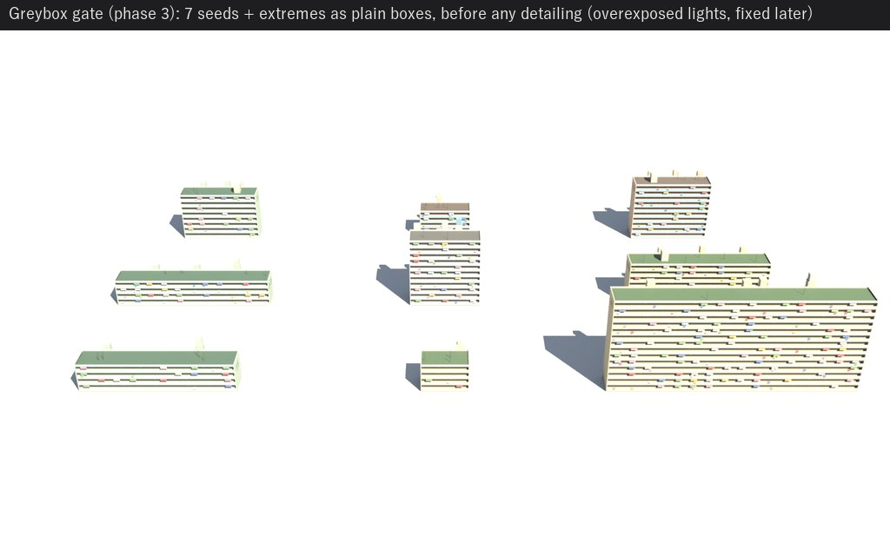
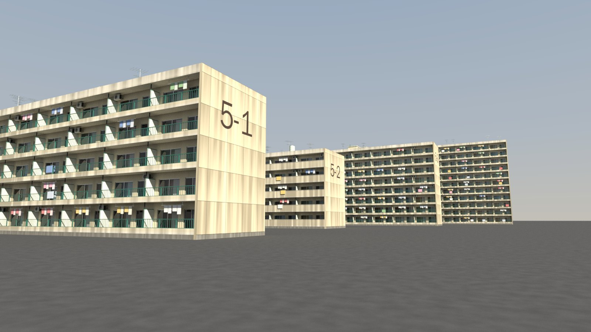
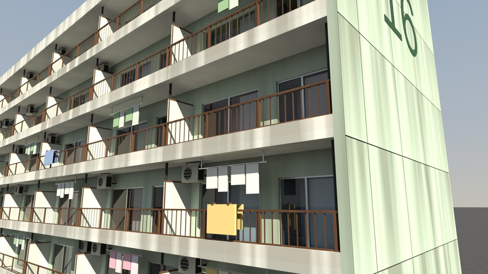
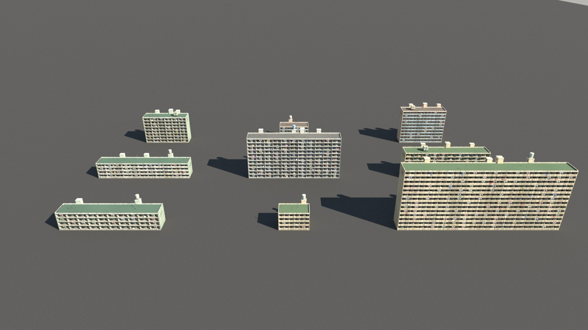

# Review 29: the procedural-assets skill, tested on a danchi generator

2026-10-25. The skill at `.claude/skills/procedural-assets/` distils how AAA environment
and technical artists build modular kits and procedural generators. It draws on three
research reports covering Bethesda's kit process, Epic's City Sample, Embark's THE FINALS
buildings, Insomniac's trims, SideFX Labs, Adobe's PBR guide and building-science sources on
weathering, plus reviews 26 and 28.

## Test

A fresh Claude Code session (Opus 5.5, `claude -p`) ran in this repository with the 2.1
HocusPocus server. Its brief asked for a 1980s Japanese public-housing block (danchi)
generator for a game, and did not mention the skill.

- **The skill triggered on its own.** The session's first call loaded it, and the agent read
  all five reference files before connecting to Houdini.
- **It followed the phases in order.** It went brief, metrics, de-risk spike, plan, greybox
  contact sheet, kit detail (most-used pieces first), variation sheet, materials,
  water-driven weathering, LODs with a measured brightness match, collision, HDA,
  fresh-scene install test, then evidence. Its log is `29-logs-danchi.md`.
- **The plan was points with attributes, the pieces were 14 separate kit wrangles**, and
  placement was Copy to Points. Connective geometry (plinth, end walls, roof) was generated
  outright. The end-wall numbers used the Font SOP.

| | Value |
|---|---:|
| Wall time | 86 min |
| HocusPocus calls / errors | 192 / 2 |
| `houdini_python` calls | 16 |
| LOD0 / LOD1 / LOD2 triangles, default block | 32,410 / 6,618 / 438 |
| LOD0, worst case (14 floors × 16 bays) | 168,600 |

Most of the 16 `houdini_python` calls were deliberate. They covered a script that wired
about 80 MaterialX connections, checks of node availability, winding and triangle counts,
and the FBX re-import. The rest went to things the tools do not expose.

## What the test changed in the skill

The agent's slowdowns became recipes:

- **Copy to Points 2.0 made by script copies no target attributes.** Its `targetattribs`
  multiparm starts empty, so the copies came out black.
- **VEX overload ambiguities** when writing blind, and `smooth()` rather than
  `smoothstep()`.
- **Karma light scale.** Also, an environment light is invisible to the camera unless
  `light_contribprimary` is on.
- **Opaque glass hides modelled rooms and lit windows.** It only shows at night, so test
  night early.
- **The look capture folder keeps the newest 50 images.** Save gate images with
  `look {output}` when you make them.
- **SideFX Labs is not installed here.** Check with `search` before planning around Labs
  nodes. The Font SOP takes a font name, and Houdini ships a CJK font.
- **Phase 0 now includes a de-risk spike.** The agent invented it, and it saved a late
  redesign.

## HocusPocus findings for 2.2

1. `cook {profile: true}` treats a locked asset as one node and already-cooked nodes as
   cached. It cannot prove that a branch inside an asset costs nothing. The agent fell back to
   cook counts through `houdini_python`.
2. `inspect problems` reports the Font SOP's `file` parm, which takes a font name, as a
   missing file.
3. Wiring large MaterialX networks as `edit` ops is long enough that the agent wrote a Python
   script instead. A material recipe op, or a VOP-network `build` from data, would remove it.
4. The look capture folder's 50-image limit should be stated in `look`'s description, or
   raised.

## Verdict

The skill does what it was written for. An agent without it built the neo_tower as one large
VEX generator and detailed early. With it, an agent worked coarse to fine, made each kit
piece separately, measured at every gate, and shipped a tested asset. The result is still
an agent's work: clean, believable and well structured, but without the hand-painted grime,
signage density and art direction a human artist would add.
