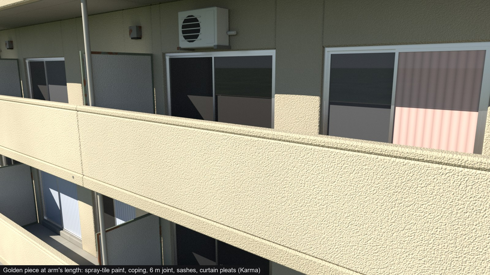
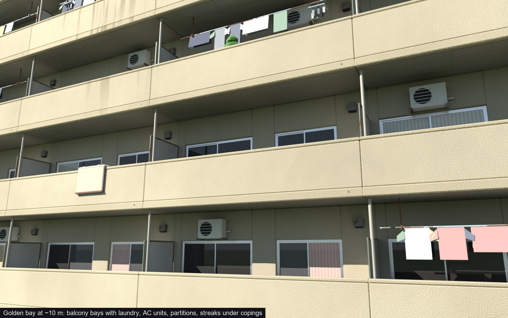
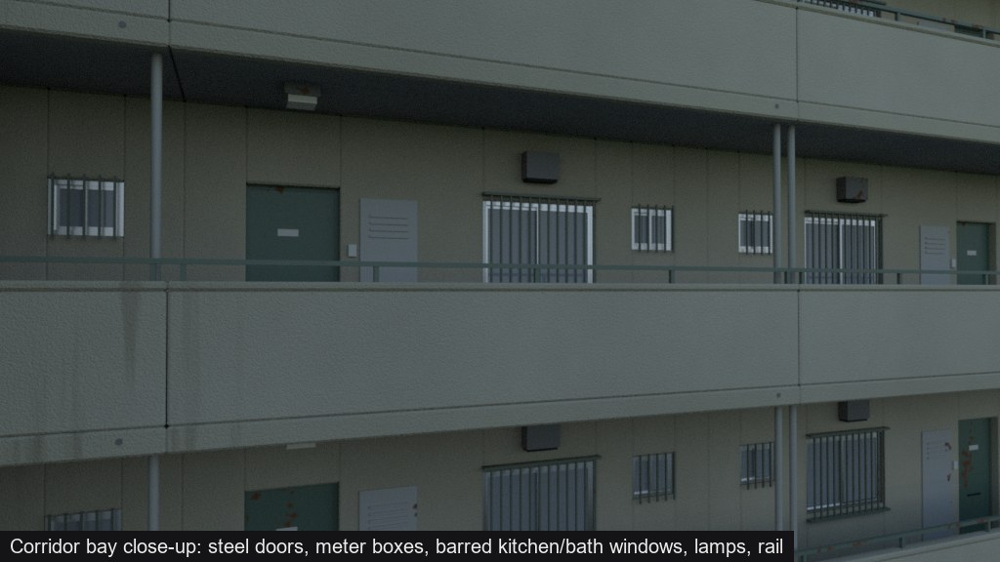
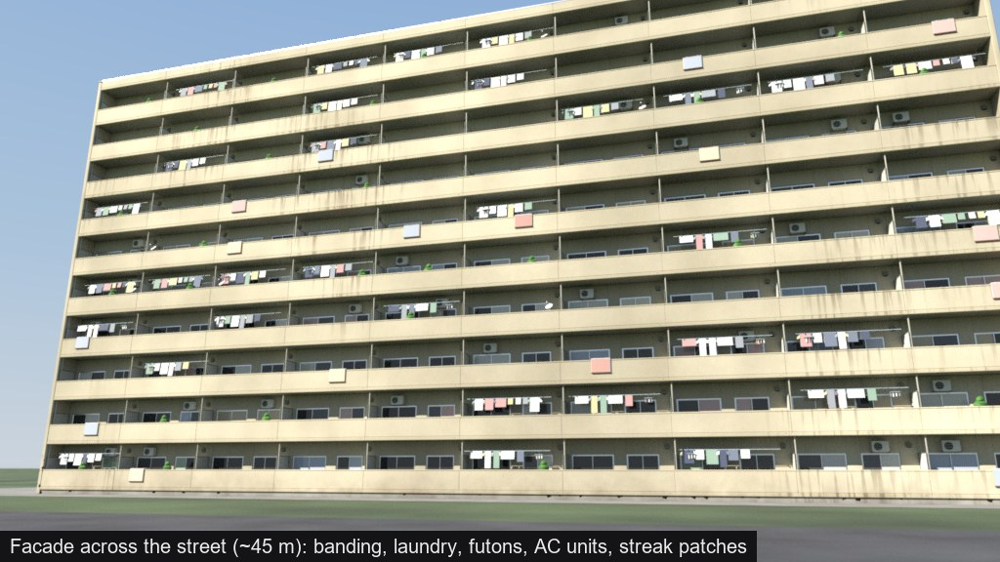
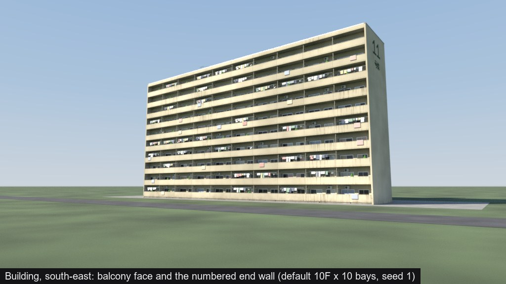
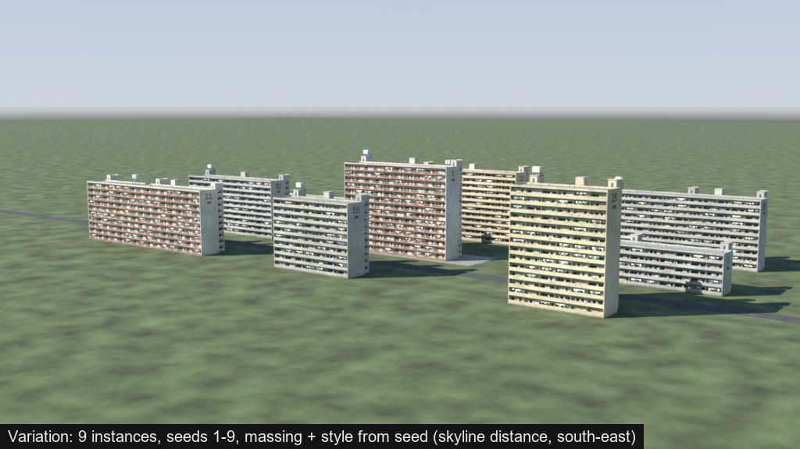
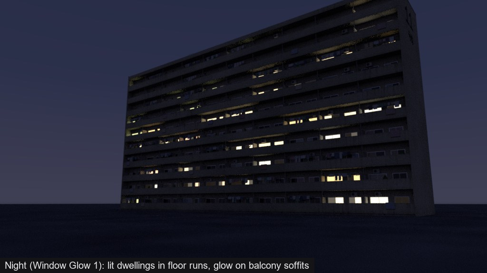
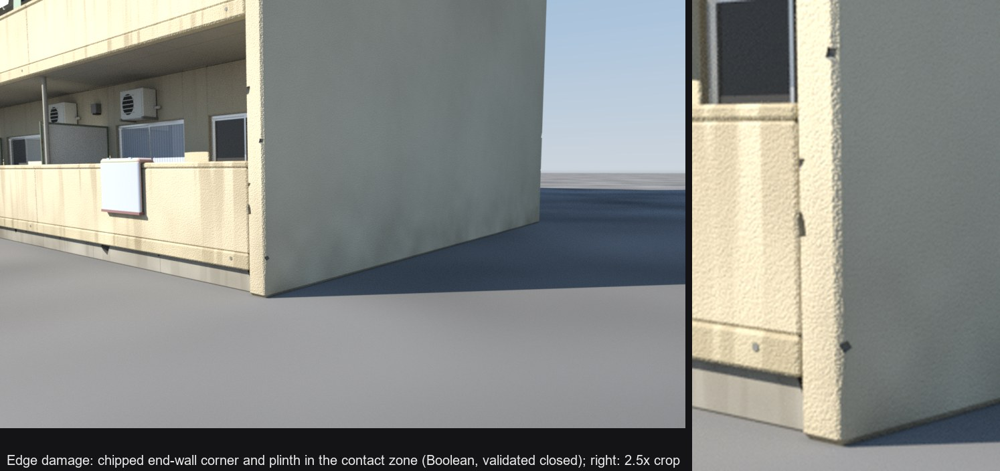
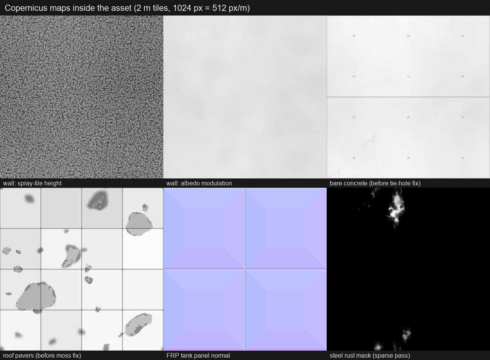

# Review 30: recursive coarse-to-fine kits, and the damage and materials skills

2026-10-25. Review 29's danchi read well as a whole and poorly up close. Coarse-to-fine had
run once, over the whole building, so no piece got past greybox quality. The user's
correction was to run coarse to fine on the smallest pieces first and again at every level
up. Mesh damage and materials also became skills of their own.

- **`procedural-assets`:** rewritten around levels L1 piece, L2 bay, L3 facade, L4 building,
  L5 block. The order is: a contract, a short functional skeleton, a golden piece, then a
  golden bay. Each level up runs its own blockout, refine and detail passes, judged at that
  level's distance.
- **`procedural-mesh-damage` (new):** cause-driven chips, breaks and erosion with tested VEX
  for chip points, convex edges, SDF erosion and validation.
- **`procedural-materials` (new):** Copernicus material authoring, from height to derived maps
  to masks to the story layer, with tested graph templates and the correct file encodings.

## Test

Same brief as review 29, run in a fresh `claude -p` session with HocusPocus 2.1. All three
skills triggered on their own; the procedural-assets skill was loaded before the first
Houdini call. Its log is `30-logs-danchi-v2.md`.

| | Review 29 | Review 30 |
|---|---:|---:|
| Wall time | 86 min | 88 min |
| HocusPocus calls / errors | 192 / 2 | 181 / 9 |
| `houdini_python` / `edit` calls | 16 / 55 | 70 / 5 |
| Karma looks | — | 50 (about 30 final renders, the largest time cost) |
| LOD0 / LOD1 / LOD2 triangles, default building | 32,410 / 6,618 / 438 | 304,418 / 17,474 / 154 |

The agent followed the new phases in order, and the evidence images are named after them:
skeleton, golden piece, golden bay with lit and grayscale iterations, kit sheet, facade,
building, LOD value match, variation, night, damage, texture maps.

## Did quality improve?

**Up close, clearly.** Compared with review 29's close-up (`evidence/danchi/03_closeup_balconies.jpg`):

- Surfaces carry real material. Review 29's walls were flat colour with repeated vertical
  stripes; now they carry Copernicus spray-tile paint, with formed concrete at the joints.
- Edges hold light. A 2 cm chamfer with area-weighted normals is used everywhere, and the
  copings and slab-edge bands stand 1 cm proud.
- Windows have sash stiles, reveals, curtains with pleats, insect screens and frosted
  kitchen glass.
- The corridor bay has deep-set steel doors, meter boxes, barred windows and lamps.
- Weathering has a structure. Streaks fall below copings in patches, and whole stretches are
  left clean. Review 29 streaked every surface at the same density.
- The agent iterated on the golden bay itself. It caught overexposure, uniform streaks,
  candy-coloured laundry and rusting plastic pipes before building anything else.

**At distance, a little.** The facade and building read as a danchi with believable value
structure. The nine-seed estate shows three palettes and real massing variation. The LOD
brightness match was measured and corrected to within 1 %.

**What is still weak:**

1. **The end walls.** The 30 m gables are the largest flat surfaces in the hero views. They
   are generated once per building, not instanced as kit pieces, so no golden pass reached
   them; they are plain boxes with a number. The skill now says connective geometry gets the
   golden-piece pass.
2. **Soft props.** Laundry and futons are still flat cards. The skill now asks for sag,
   folds and thickness.
3. **Damage barely reads.** The chips are correct and validated closed, but at 3–5 cm they
   hardly show even at 5 m. The first pass was far too dense, because the chamfer doubled
   the convex edges over a 30 m wall. The skill now sizes damage by pixels at the judging
   distance, and finds chip points on the pre-bevel shape.
4. **Interiors** are dark rooms behind glass. The brief did not ask for more.
5. **Cost.** LOD0 rose about ten times to 304k triangles per building, mostly props and
   chamfers. The packed branch instances the kit (387 instances), so unique triangles are
   far fewer. Budgets are per piece and were met; a per-building budget is the next thing
   to set.

## Why `houdini_python` rose from 16 to 70

The agent kept the generator as source files: `lib.vfl`, one `.vfl` per piece family, and
`build.py`, `tex.py`, `mat.py`, `present.py` and `checks.py`. It ran them with
`houdini_python` `exec(open(...))`, so a rebuild was one call. About 40 of the 70 calls were
those scripts. The rest were small probes and camera setup. Five calls failed on the agent's
own Python errors.

This is a fair pattern for a generator with dozens of wrangles. It is reproducible and
diffable, and the HDA embeds the snippets. The cost is that a script bypasses `edit`'s
validation. The `edit` calls were few, and one of them hit a tool trap (below). The recipes
now describe the build-script pattern and when to switch to `edit` `value_file` / `patch`.

## HocusPocus finding: a `create` input key dropped silently

`edit {op: create, inputs: [{from, from_output: 1}]}` wired output 0 with no error. `create`
spells it `output`, and `connect` spells it `from_output`. The FBX export then carried the
collision branch as the mesh, which the agent found only by re-importing the export.

PR #17 accepts `from_output` as an alias, and makes an unknown key in an input link
`invalid_argument` naming it.

## What the test changed in the skills

- **procedural-assets:**
  - connective and unique geometry gets the golden-piece pass;
  - props follow the three-size rule; soft goods need sag and folds, in muted colours;
  - LOD0-only detail branches off after the LOD split;
  - the LOD value match targets about 3 % and explains why a shell reads bright.
- **hocuspocus-recipes:**
  - VEX traps: no shift operators, vector literals hold constants, functions come first;
  - the build-script pattern;
  - `displayColor` instead of `Cd` in MaterialX;
  - Copy to Points apply menus take tokens;
  - the Font SOP `lod` parm;
  - re-import every export.
- **procedural-mesh-damage:** chamfers double the convex edges; size damage for the judging
  distance; keep damage out of LOD1; check the chip count against budget.
- **procedural-materials:** a section on the story layer for tiling kits, placed in the
  shader from generator primvars with a patch mask (the run's best idea). Also traps for
  saturated grunge masks and `displayColor`.
