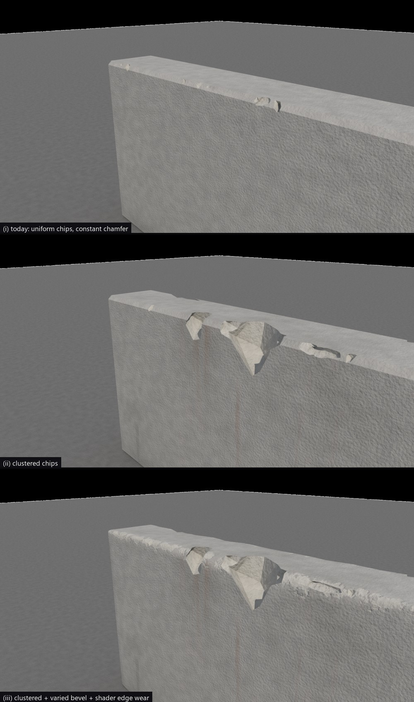
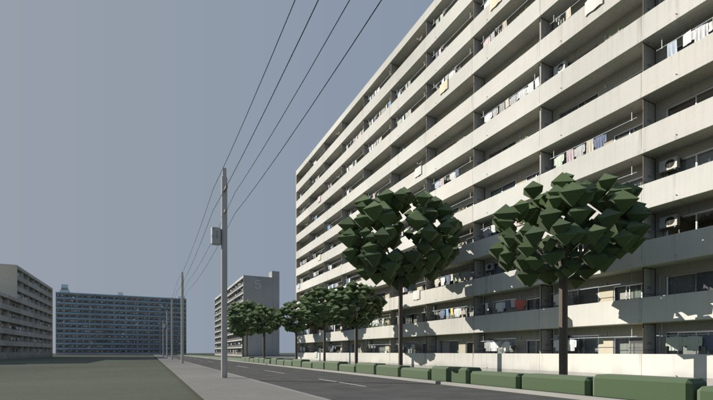
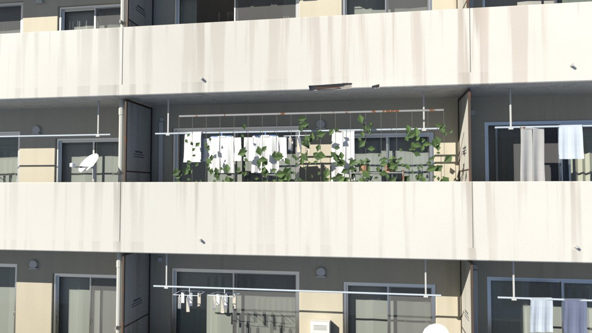
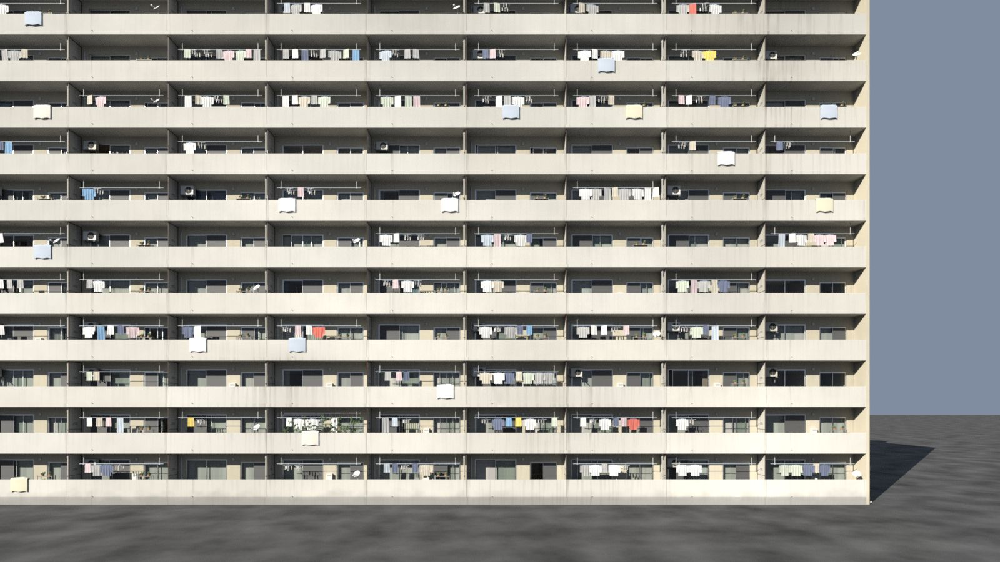
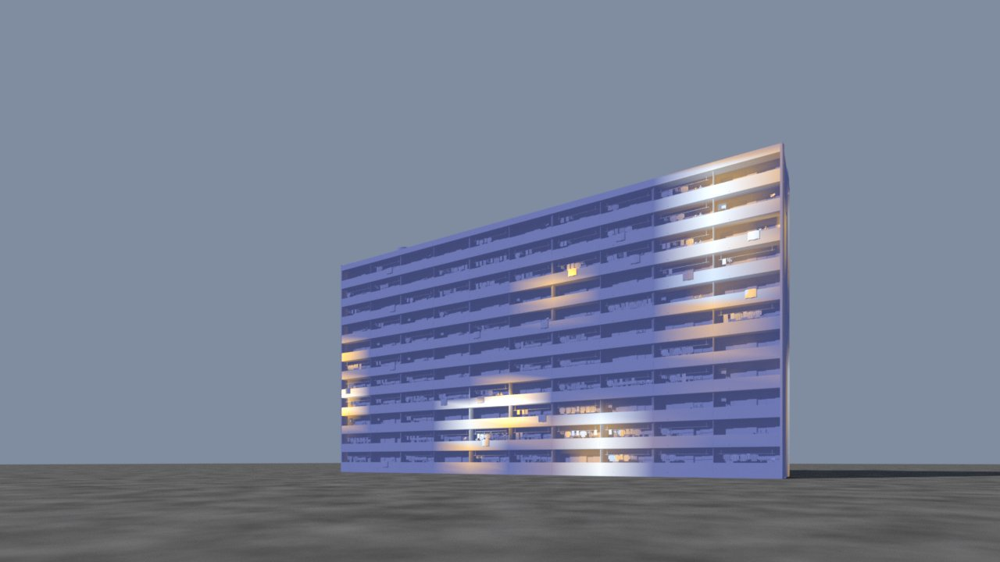
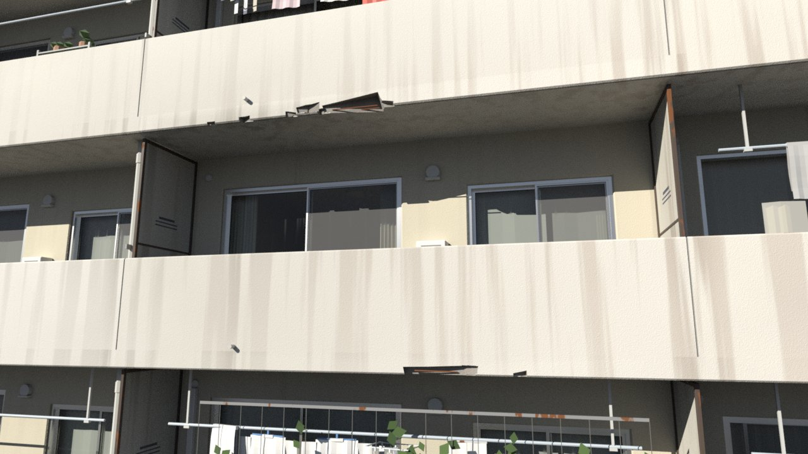
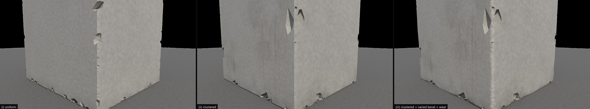
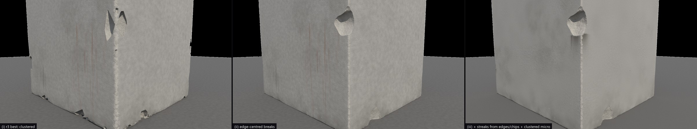
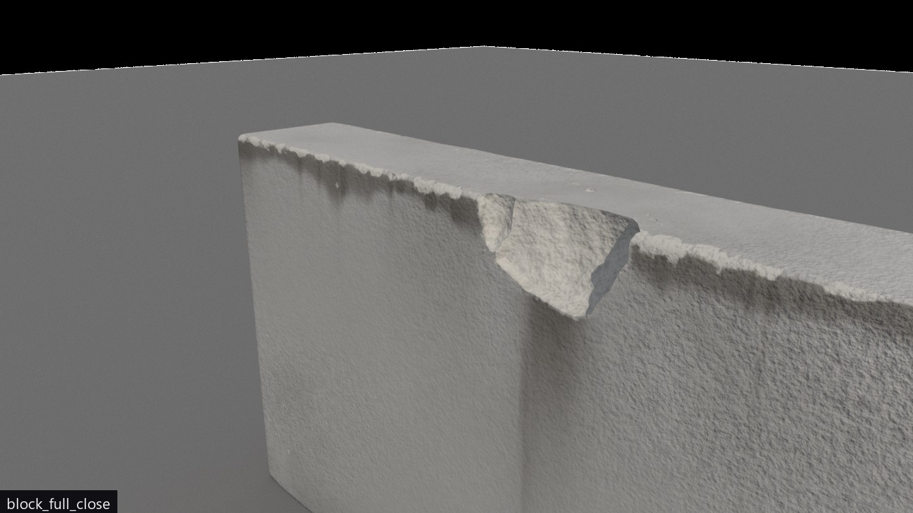
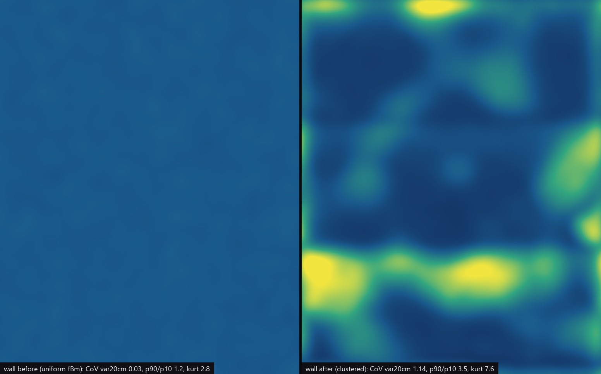

# Review 31: realism research, clustered and caused detail, edges first

2026-10-26. The user judged the review-30 danchi "substantially better, but still a little
lacking" and asked for two research rounds:
- **Round 3:** apply the 80/20 rule. About 80 % of a notable detail sits on about 20 % of the
  surface, over a low background; and in general, what makes assets and textures believable.
- **Round 4:** follows the user's review of the round-3 damage prototype. Edges take damage
  first and faces smaller damage, never two big divots flanking an edge. Streaks start at edges
  and at the lower lips of divots. Study how weather and people act on objects. Apply the 80/20
  rule to the fine noise too, and look at visual references.

Each round ran parallel research workers and a hython prototype, folded the results into the
three skills, and then ran a fresh agent on the same danchi brief.

## Round 3

**Research** (reports in `docs/redesign/research/r3-*.md`):
- **Clustering.** Composition, not scatter. Clusters are needed at every level, and one cause
  field drives every layer. Thresholded fBm still looks uniform, because its statistics are
  the same everywhere.
- **Believable assets.** Imperfection that keeps snapping, layers of history, a persona per
  flat, layered interiors, presentation.
- **Believable textures.** Rain first cleans, then soils (PCI DN-29). Roughness comes from
  causes, dirt is a colour, and hex tiling breaks repeats.

**Prototype.** A cluster mask and clustered chip points put 80 % of the damage on 18–23 % of
the edge length. Chips were 7.7–17× denser inside the hotspots than outside, against 1.6–2.5×
for the even spread.

**Run (danchi v3).** 136 min, 183 HocusPocus calls (11 errors), 100 `houdini_python`. The
agent followed the new guidance:
- personas per flat, AC units in three generations, laundry with folds, futons, a hero green
  curtain;
- each pane tilted slightly, and layered rooms behind the glass;
- a cause field with facade stories;
- a street-level hero shot with road, poles and wires, under a 28° sun.

It also showed what was still wrong:
- streaks were even bands on every parapet;
- spalls on slab edges were flat plates;
- trees were faceted blobs;
- the micro grain was the same everywhere.

## Round 4

**The user's review of the r3 prototype.** On the wall corner, two large divots flank one edge.
Edges should take damage first and faces less. Streaks start at edges and at the lower lips of
divots. The small noise is still too evenly spread.

**Research** (reports in `docs/redesign/research/r4-*.md`):
- **Weather.** The force needed to chip rises linearly with distance from the edge (NPL MAT 76,
  NIST edge toughness). One blow makes one asymmetric scar that removes the arris; the struck
  face keeps a small platform. Water leaves at the lowest point of an edge, so a chip in a top
  edge becomes a streak source. Wind washes windward vertical edges, and sheltered undersides
  keep crust.
- **Human and industrial wear.** Building codes fix the heights of touch points, and protection
  products mark where strikes land: rack damage below 300 mm, dock tracks 0–0.9 m, kick plates
  around 200 mm. Touch wear concentrates on a few hot points, and traffic funnels.
- **Micro noise.** Real fine detail is Gaussian noise times a spatially varying amplitude
  (Portilla–Simoncelli, Gaussian scale mixtures). The danchi spray-tile grain measured as plain
  stationary noise: 90th/10th percentile local contrast 1.06×, kurtosis 2.4. There is a catalogue
  by surface, clustered or blue-noise scatter, and power-law or lognormal sizes.
- **Visual references.** About 75 photographs. Arris damage is mostly runs of overlapping small
  bites (9 of 19), with fewer single shell breaks (6 of 19). One face loses (12 of 15). Both
  faces lose only at corners, as one wedge, and no photo showed flanking divots. Every streak
  started at a feature (17 of 17). Railings rust at rail tops, junctions and post bases. Door
  grime is a band along the latch edge.

**Prototype v2.** The r3 chip script pushed each cutter in along the edge bisector and flattened
it, so it reached both faces but missed the arris. A new probe counts that pattern:

| | r3 | v2 |
|---|---|---|
| Wall seeds (of 10) with flanking divots | 9 | 0 |
| Largest face feature ÷ largest edge break | 0.14–0.31 | 0.07–0.08 |
| Micro layer, CoV of 20 cm window variance | 0.03 | 1.1 |
| Micro layer, local-std 90th/10th percentile spread | 1.2 | 3.5 |
| Micro layer, kurtosis | 2.8 | 6.9–7.6 |

- **Validation:** every seed is closed, with 0 non-manifold edges and the block's seams
  unchanged.
- **Streaks:** they start at top edges with no drip (a dark band plus a fringe), at edge ends,
  and at the lower lips of chips. 24 of 36 qualifying chips on the wall got one.
- **Cost:** about 2.8× the triangles of r3, mostly from run bites and pits.

**Still weak.** Large breaks come out as smooth rounded scoops, because the cutters are
displaced only by low-frequency noise; broken concrete is angular and grainy. The streak from
the wall chip starts as a hard-edged strip. Both are written into the skill as traps.

## What changed in the skills

- **procedural-assets:**
  - clusters with a background, and a cause stage in the plan;
  - study photographs and count what recurs;
  - interaction points and a traffic field as causes;
  - layers of history, personas and interiors;
  - presentation, and context props held to the same bar;
  - `references/believability.md`.
- **procedural-materials:**
  - weathering by the physics of water;
  - roughness from causes, albedo variation by scale, dirt as a colour, hex tiling;
  - edges first and streaks from sources; touch and traffic; clustered micro detail;
  - `references/realism.md`, `weather-and-use.md` and `micro-noise.md`.
- **procedural-mesh-damage:**
  - edges take the damage and faces dissipate it, with one asymmetric scar per impact and no
    mirrored pairs;
  - runs, shells and corner wedges, weighted by edge exposure;
  - the clustered mask;
  - streak and micro fields on a dense render copy;
  - `references/causes.md`;
  - tested scripts: `cluster_mask`, `chip_points_edge`, `cutter_shape`, `streak_sources`,
    `streak_mask`, `micro_fields`, `damage_measure`;
  - a fix to `chip_points.vfl`'s seam margin.

The round-4 run on the same brief is in progress. Its results will be added here.
