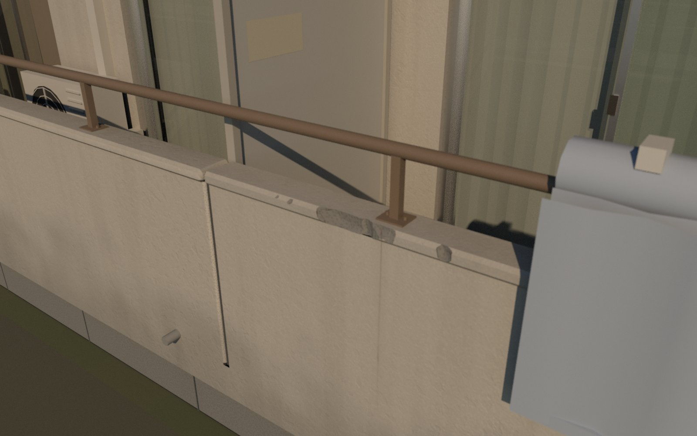
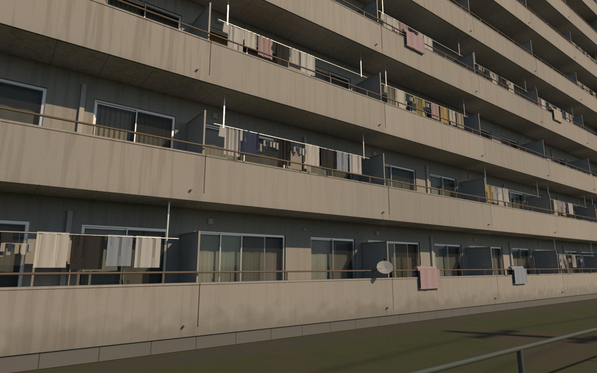
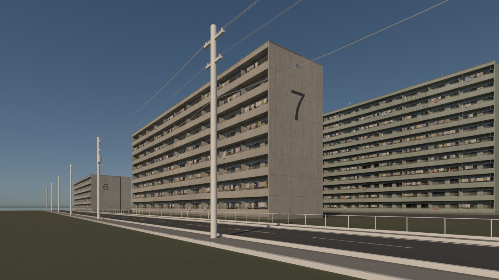
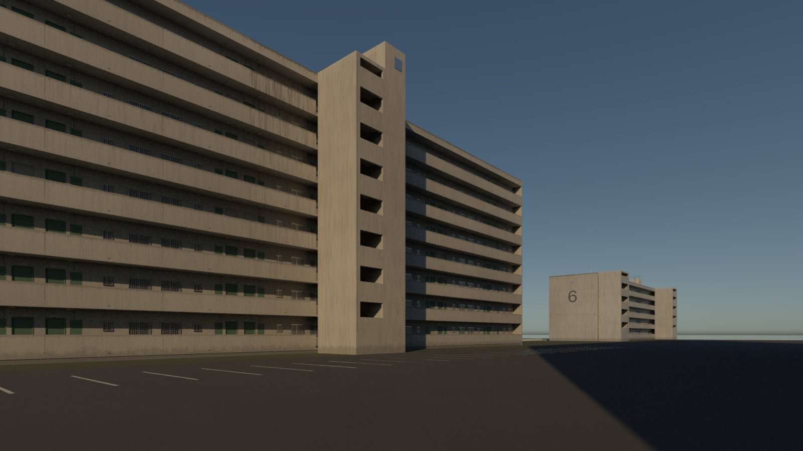
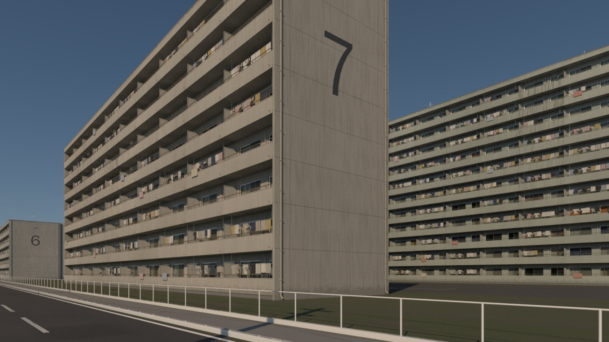
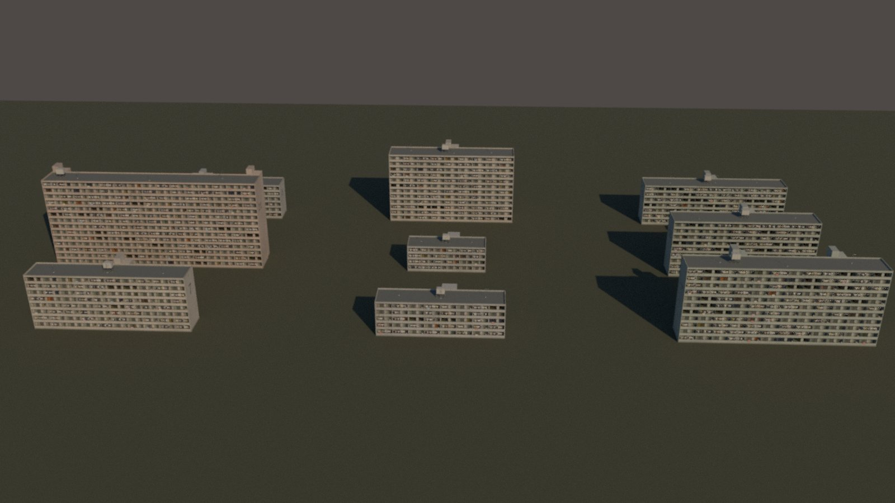

# Review 32: round 5, the skills used in full; layering, simulation and meta research

2026-10-27. Round 4's agent loaded only `procedural-assets`. It never opened the companion
references or the damage scripts, so it made no mesh damage and repeated a uniform streak fringe.
The fix was a per-phase reading checklist in `procedural-assets` (review 31). Round 5 ran the same
danchi brief to test it. Alongside it, the user asked for three research reports: texture
layering and mixing, wear simulation, and meta research on what else to study.

## Run (danchi v5)

| | v4 | v5 |
|---|---:|---:|
| Wall time | 184 min | 103 min |
| HocusPocus calls / errors | 225 / 5 | 170 / 8 |
| Karma looks | 85 | 45 |
| Skills loaded with the Skill tool | 1 | 3 |
| Reads of `causes`, `weather-and-use`, `micro-noise` | 0 | all |
| Damage scripts used | none | `cluster_mask` → `chip_points_edge` → `cutter_shape` → Boolean, then `damage_validate` and `damage_measure` |
| Usage (Claude Code's API-price estimate) | $43 | $24 |

**The checklist worked.** All three skills were loaded and their references read, and the damage
pipeline ran as written. The run finished faster and used less than v4.

**Damage on the balcony copings:**
- Three seeded variants on about a third of the instances; the rest keep background wear only.
  That is the 80/20 rule across instances.
- `flank_runs` was 0 on all three variants, and the edge share of cut area was 0.998–0.999.
- `face_to_edge` was 0.22–0.34; one variant is slightly over the 0.3 target.
- The meshes are closed, with seams unchanged and no cut faces at uv (0,0).
- The first pass made about 750 cutters and 15–20k triangles per coping, mostly bites too small
  to see at 10 m. A higher size floor and a PolyReduce gave 2.4–3.5k triangles.

**Surfaces:**
- **Colour.** Desaturated grey-beige concrete, the most photographic palette so far; v4's
  saturated cream is gone.
- **Texture.** Spray-tile paint built as flat-topped mesas with troughs, times a clustered
  envelope; a 12 m world-space value wash; dirt as a colour; a damp splash band with a ragged top.
- **Streaks only from features.** 399 decals and 168 fringe strips:
  - spout fans;
  - rail-post rust runs, biased toward neglected flats;
  - V pairs at sill ends;
  - a fringe with a dark band under tops without a drip groove;
  - a fine fringe on parapet inner faces;
  - lines down the sides of pipes.

**Still weak:**
- The trees are missing again, and the 9-up variation sheet is an aerial over a bare plane, which
  believability.md warns reads as a miniature.
- Laundry is still card-like, and some laundry poles render as bright white lines.
- The chips are correct but small and flat-lit at bay distance.

**Traps from the log, now in the skills:**
- sub-centimetre bites are invisible at bay distance and expensive;
- the kit's smooth normal pass turns chips into bulges, so damaged pieces need their own
  normals at a 25° cusp;
- `polyreduce` `hardfeatureedges` is a group, not a toggle;
- Connectivity's parms are `connecttype` and `primincgroup`;
- `hou.Parm.set` on some menu parms takes an index, not a token;
- `cellularnoise` has `smoothedge`, not the gap and bevel parms that `copernicus.md` listed.

The agent's own note: "Nothing in the HocusPocus tools themselves blocked the work."

## Research

Full reports are in `docs/redesign/research/r5-*.md`.

- **Texture layering** (`procedural-materials/references/layering.md`). Height blending is the
  core operation: one recipe for a single height, and the "max height" recipe for several layers.
  Also: the stack order, which blend operator suits which layer, reoriented normal blending
  (never lerp normals), ORM packing, bake versus shader time (The Order: 1886 used "90-95% tiling
  materials, with up to 4 runtime material layers"), mean-neutral detail maps, and Toksvig for
  roughness mips. It translates each technique to Copernicus and MaterialX and notes the Karma
  limits: compositing nodes such as `mtlxoverlay` are unsupported.
- **Wear simulation** (`procedural-mesh-damage/references/wear-simulation.md`). Simulate only
  where transport, history or interaction matter; for local-only causes, rules are as good at
  1/10–1/1000 of the cost. Simulate once per piece or assembly, bake, and apply rules at scale.
  Seven Houdini recipes: rain run-off tracing, global dirt, impacts from causes, Helbing trails,
  Vellum rails, corrosion spread, and Paquette peeling with right-angle T-junctions. None of
  them has been tested yet.
- **Meta research** (`r5-meta.md`). Everything researched so far is surface realism. Three areas
  are unstudied:
  - picture-level art direction: value structure, colour and saturation budgets, composition
    and focal point;
  - judging a generator by the spread of its output across many seeds;
  - the anime-background style the brief names.

  It also proposes a 13-test self-critique toolkit an agent can run on renders with numpy and
  PIL, calibrated against the user's A/B picks so it can stand in for an art director's eye.

## Next

Proposed by the meta research and not yet started; each needs the user's go-ahead:
- **A:** a `frame_critique.py` with the numeric read tests, plus an art-direction reference. It
  passes only if it flags v4's cream walls and ranks v3 above v4.
- **B:** 20–30 A/B picks from the user on existing renders, keeping only the checks that agree.
- **C:** anime-background stylisation in Karma and Copernicus.
